# Playbook de Despliegue Técnico: OpenLDAP en Ubuntu

## 1. Ficha Técnica y Prerrequisitos del Entorno

### 1.1 Tabla resumen

| | |
|---|---|
| Topología de red | Red NAT `NatJoel` (20.0.0.0/24) con DHCP deshabilitado |
| Sistema operativo | Ubuntu Desktop 24.04 LTS |
| Dirección IP | 20.0.0.5/24 |
| FQDN | ldapserver.planetafp.local |
| Dominio del directorio (DIT) | planetafp.local (`dc=planetafp,dc=local`) |
| Organización | planetafp |
| Paquetes a instalar | slapd, ldap-utils |

Red NAT creada en VirtualBox, sin DHCP:

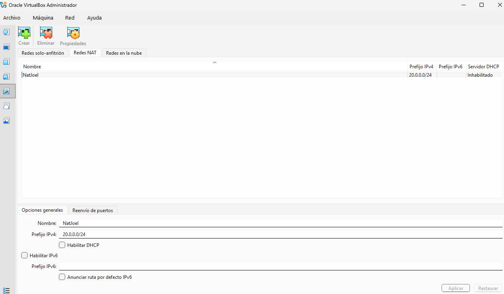

### 1.2 Descripción del servicio

LDAP es un servicio de directorio. Sirve para guardar información (usuarios, grupos, equipos...) en un sitio central, ordenada en forma de árbol. Ese árbol se llama DIT (Directory Information Tree). Está pensado para leer datos rápido y se usa mucho para que los usuarios se autentiquen.

Cada entrada del árbol se identifica con su DN, que es la ruta completa hasta ella. Por ejemplo: `uid=jmartinez,ou=DireccionAcademica,dc=planetafp,dc=local`.

Los componentes principales son:

- **slapd:** es el servidor LDAP, el programa que se queda funcionando y responde a las consultas.
- **ldap-utils:** los comandos para trabajar con el directorio, como `ldapsearch`, `ldapadd`, `ldapdelete` o `ldapmodify`.
- **libldap:** las bibliotecas que hacen que el protocolo LDAP funcione.

---

## 2. Procedimiento de Despliegue Paso a Paso

### Paso 1. Configuración de red estática

Lo primero es ponerle una IP fija al servidor. Si la IP cambiara, los clientes no lo encontrarían, así que desactivo el DHCP y escribo la IP a mano en Netplan. <br>
Fichero de Netplan:

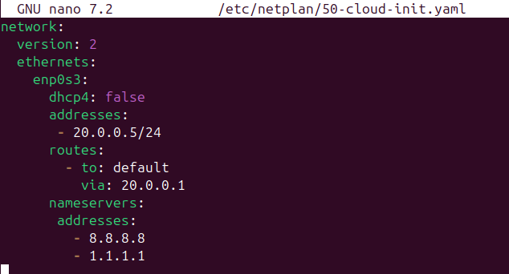

Aplico los cambios y miro que la IP ha cambiado:

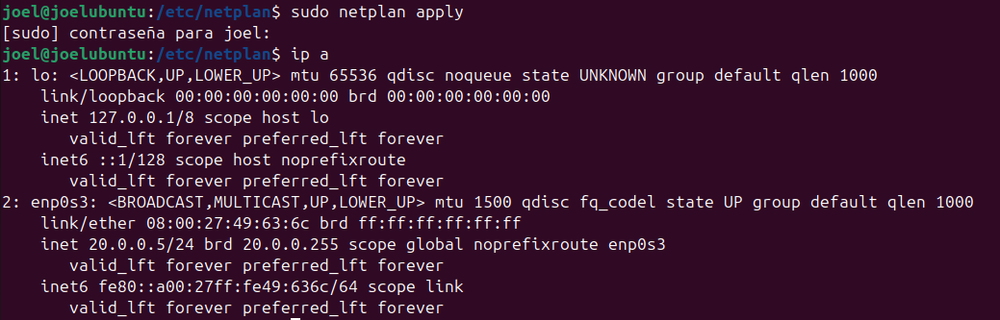

### Paso 2. Resolución de nombres local

Añado una línea en `/etc/hosts` para poder llamar al servidor por su nombre (`ldapserver.planetafp.local` o solo `ldapserver`) en vez de usar la IP. Así no hace falta tener un servidor DNS.

```
sudo nano /etc/hosts
```

Línea añadida:

```
20.0.0.5    ldapserver.planetafp.local    ldapserver
```

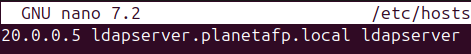

Para comprobar que funciona, hago un ping al nombre:

```
ping -c 4 ldapserver.planetafp.local
```

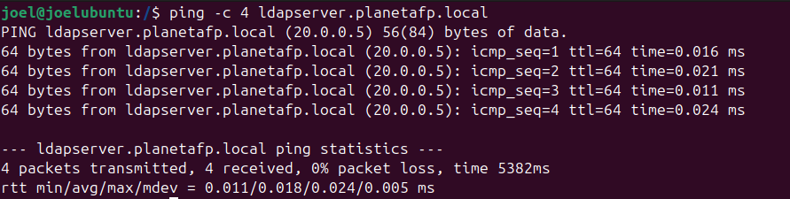

### Paso 3. Instalación de software

```
sudo apt update
sudo apt install slapd ldap-utils -y
```

### Paso 4. Reconfiguración del servicio

Al instalar, slapd se configura solo con valores por defecto, y no son los que necesito. Por eso lo vuelvo a configurar con `dpkg-reconfigure`, poniendo el dominio y la organización de la práctica.

```
sudo dpkg-reconfigure slapd
```

| Pregunta | Respuesta |
|---|---|
| ¿Omitir la configuración del servidor OpenLDAP? | No |
| Nombre de dominio DNS | planetafp.local |
| Nombre de la organización | planetafp |
| ¿Borrar la base de datos al purgar slapd? | No |
| ¿Mover la base de datos antigua? | Si |

Nombre de dominio:

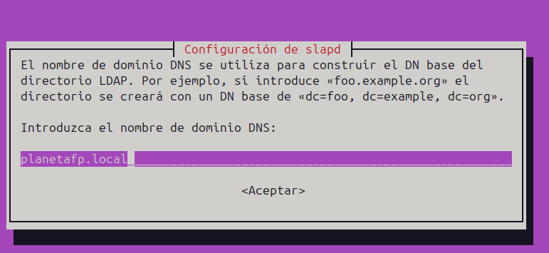

Organización:

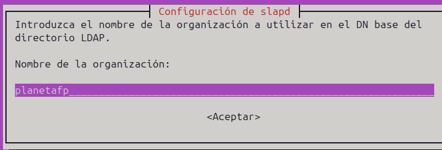

Borrar la base de datos al purgar:

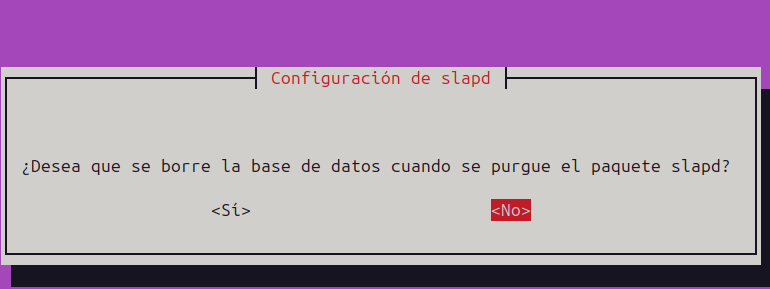

Mover la base de datos antigua:

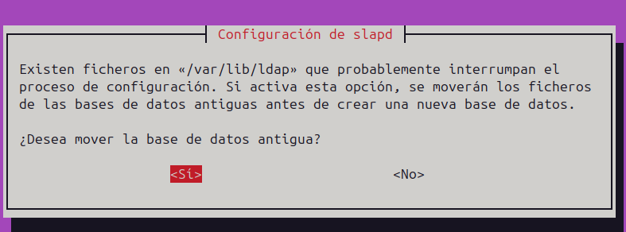

---

## 3. Verificación y Comprobación

### 3.1 Estado del demonio

Compruebo que slapd está funcionando. Tiene que salir `active (running)`.

```
sudo systemctl status slapd
```

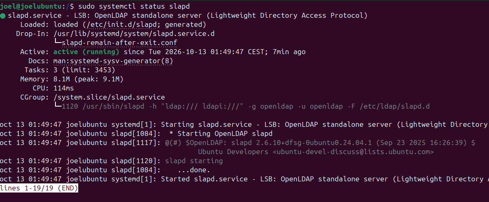

### 3.2 Esquemas del sistema

Los esquemas no hay que configurarlos, ya vienen con slapd. Solo miro que están. 

```
ls /etc/ldap/schema
```

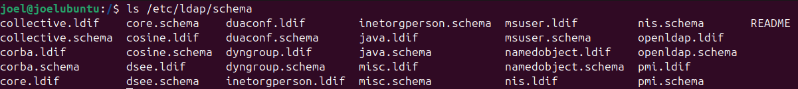

---

## 4. Población del Directorio y Operaciones Básicas

### Estructura del directorio

Este es el árbol que tengo en el directorio:

```
dc=planetafp,dc=local
├── ou=DireccionAcademica
│   ├── uid=jmartinez
│   └── uid=mgarcia
├── ou=Departamentos
│   ├── ou=Adisiones
│   │   ├── uid=lperez
│   │   └── uid=asanchez
│   ├── ou=CampusVirtual
│   │   ├── uid=cmoreno
│   │   └── uid=nfernandez
│   ├── ou=Secretaria
│   │   ├── uid=rjimenez
│   │   └── uid=pvidal
│   └── ou=SoporteTecnico
│       ├── uid=jroca
│       └── uid=anavarro
├── ou=AreasFormativas
│   ├── ou=Informatica
│   │   ├── uid=aruiz
│   │   └── uid=dortega
│   ├── ou=Empresa
│   │   ├── uid=jmolina
│   │   └── uid=mvazquez
│   └── ou=Sanidad
│       ├── uid=sramos
│       └── uid=cgil
└── ou=GestionFCT
    ├── ou=RelacionesEmpresa
    │   ├── uid=ibenitez
    │   └── uid=jflores
    └── ou=TutoresFCT
        ├── uid=kpuig
        └── uid=lmora
```

### 4.1 Fichero LDIF

Un LDIF es un fichero de texto con las entradas del directorio. Cada entrada empieza por el `dn`.

El dominio `dc=planetafp,dc=local` ya lo creó `dpkg-reconfigure`, así que lo dejo comentado para que no dé error. El fichero ahora solo crea unidades organizativas y usuarios.

```
nano ldif/usuarios.ldif
```

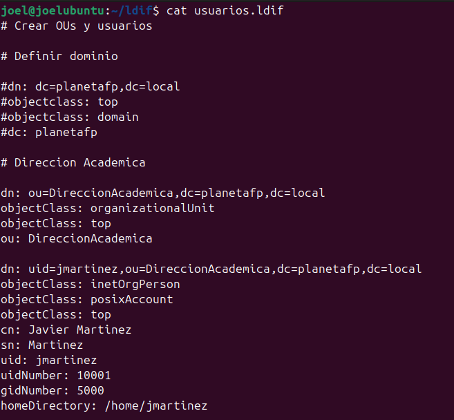

### 4.2 Inserción con ldapadd

Añado las entradas al directorio con este comando:

```
sudo ldapadd -x -D "cn=admin,dc=planetafp,dc=local" -W -f ldif/usuarios.ldif
```

- `-x`: autenticación simple
- `-D`: el usuario con el que me conecto (el administrador)
- `-W`: me pide la contraseña
- `-f`: coge las entradas del fichero

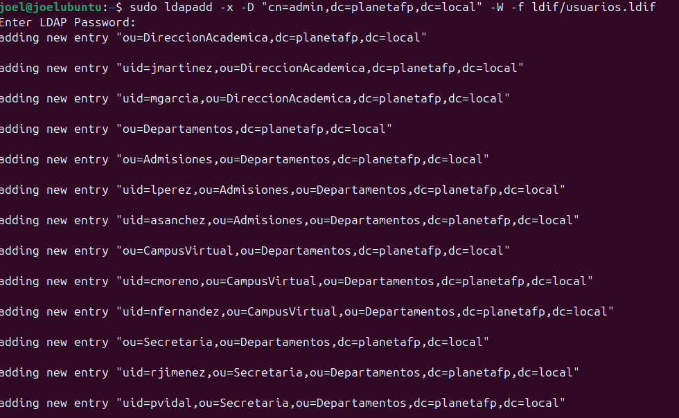

### 4.3 Consulta con ldapsearch

Para comprobar que las entradas están dentro, busco todas y pido que solo me enseñe el DN:

```
ldapsearch -x -b "dc=planetafp,dc=local" -s sub "(objectclass=*)" dn"
```

- `-b`: desde dónde empieza a buscar
- `-s sub`: busca en esa base y en todo lo que hay por debajo
- `(objectclass=*)`: el filtro, coge todas las entradas porque todas tienen objectClass
-  `dn`: solo muestra el DN de cada entrada, no el resto de atributos

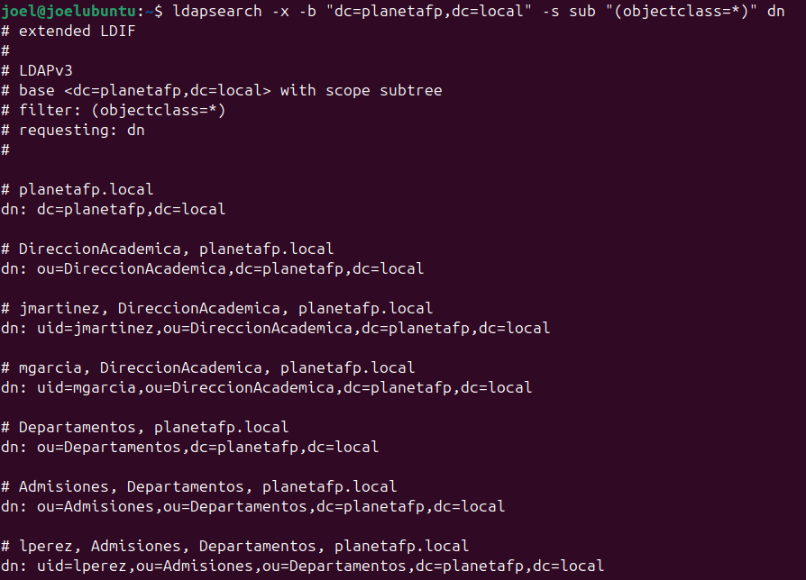

---

## 5. Control de Errores y Troubleshooting

### Error 1. ldapadd: la entrada ya existe

Al cargar el LDIF por primera vez, con la entrada del dominio sin comentar, salió esto:

```
adding new entry "dc=planetafp,dc=local"
ldap_add: Already exists (68)
```

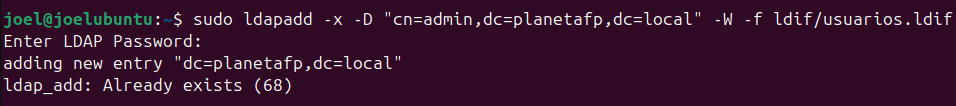

**Causa:** el LDIF intentaba crear `dc=planetafp,dc=local`, pero ya existía porque lo creó `dpkg-reconfigure` al configurar el dominio. No se puede añadir dos veces la misma entrada, y `ldapadd` se para en el primer error, así que no llegó a crear nada más.

**Solución:** comentar con `#` las líneas del dominio en el LDIF y volver a ejecutar el mismo `ldapadd`. Así solo crea la unidad organizativa y el usuario.

### Error 2. Netplan: la ruta no tiene `via`

Al aplicar la configuración de red salió esto:

```
Error in network definition: global unicast route must include both a 'to' and 'via' IP
- to: default
```

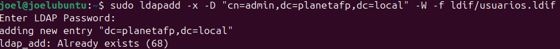

**Causa:** puse `via:` con un guion delante (`- via:`). Así YAML lo toma como una ruta nueva, y entonces `- to: default` se queda sin `via`, y la otra ruta sin `to`. Una ruta necesita las dos cosas en la misma entrada.

**Solución:** borrar el `-` de delante de `via:` y volver a aplicar Netplan:

```
sudo netplan apply
```
