# Playbook: despliegue de FusionDirectory y NFS con control de acceso LDAP

**Entorno:** Ubuntu Server y cliente  
**IP del servidor:** `20.0.0.5`  
**Dominio base LDAP:** `dc=linksight,dc=local`

---

## Módulo A: instalación y configuración de FusionDirectory

### 1. Dependencias y repositorio

Para habilitar la interfaz web se necesitan Apache y PHP.

> **Compatibilidad:** comprueba qué versión de PHP admite la versión de FusionDirectory que vas a instalar y la versión de Ubuntu utilizada. No instales PHP 7.4 automáticamente si no es compatible o no está disponible en los repositorios configurados.

Instalamos los paquetes base:

```bash
sudo apt update
sudo apt install apache2 php libapache2-mod-php \
  php-ldap php-mbstring php-xml php-curl php-intl -y
```

> Además, hay que añadir el repositorio oficial de FusionDirectory y cargar sus esquemas con `fusiondirectory-schema-manager`.

### 2. Asistente web de configuración

Abrimos en el navegador:

```text
http://20.0.0.5/fusiondirectory/setup.php
```

El asistente muestra varias pantallas para completar la configuración.

#### Bienvenida y comprobación de la instalación

La pantalla de bienvenida inicia el asistente. Después, este valida las extensiones de PHP. En este entorno, las comprobaciones de módulos como LDAP, `mbstring` e `intl`, así como las de configuración de PHP, indicaron **Ok**.

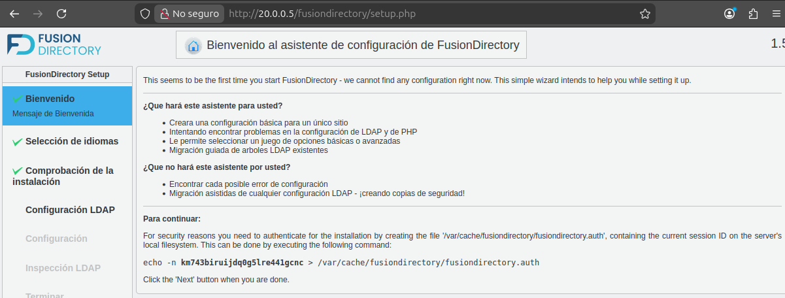

#### Token de seguridad

El asistente solicita crear un archivo de autenticación en el servidor. Hay que ejecutar que aparece en tu pantalla, usando el token generado por la instalación:

```bash
echo -n '<TOKEN_GENERADO_POR_EL_ASISTENTE>' | sudo tee /var/cache/fusiondirectory/fusiondirectory.auth >/dev/null
```

#### Selección de idioma

Seleccionamos **Spanish (Español)**.

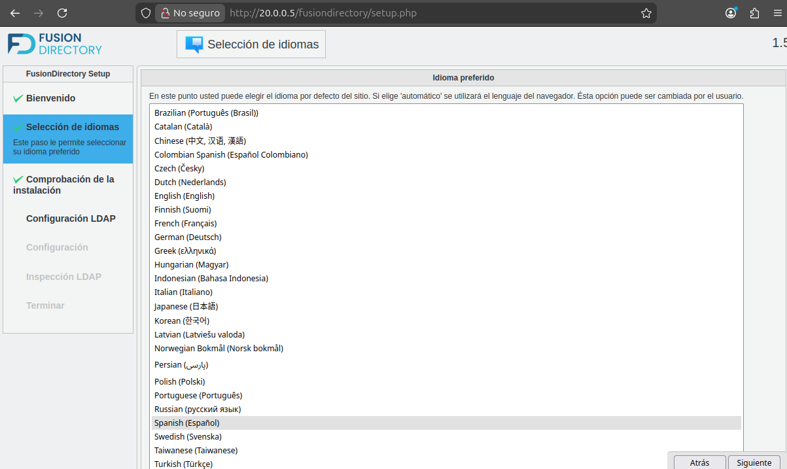

#### Comprobar la instalación
En este apartado solo comprobamos que no hay errores en los módulos o extensiones de php

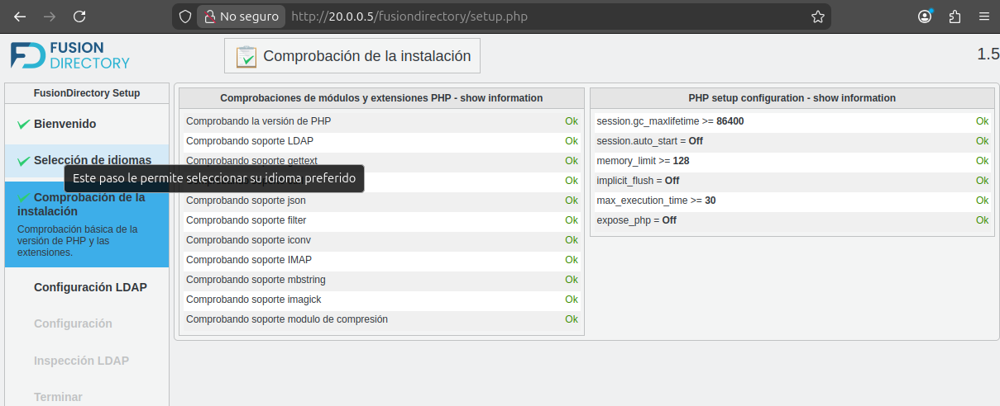


#### Configuración LDAP

Introducimos los datos de conexión con OpenLDAP:

| Campo | Valor |
|---|---|
| Nombre de localización | `default` |
| URL | `ldap://localhost:389` |
| Base | `dc=linksight,dc=local` |
| DN del administrador | `cn=admin,dc=linksight,dc=local` |

A continuación, introducimos la contraseña del administrador. El asistente debe confirmar que la conexión se ha establecido correctamente.

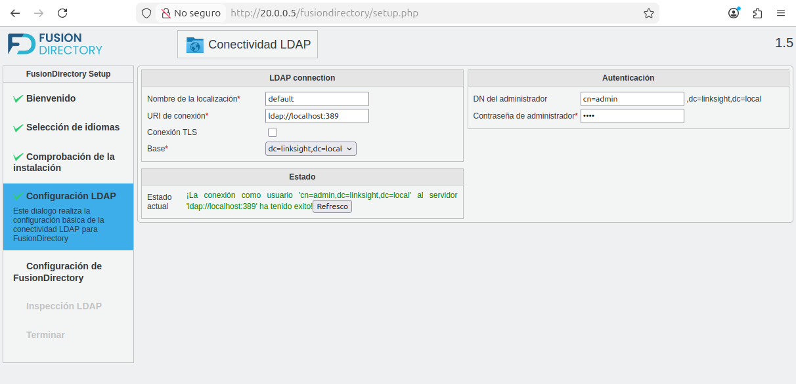

#### Configuración de FusionDirectory

En el apartado **Almacén de grupos y usuarios**, configuramos:

| Campo | Valor |
|---|---|
| Usuarios RDN | `ou=usuarios` |
| ACL Rol RDN | `ou=acroles` |

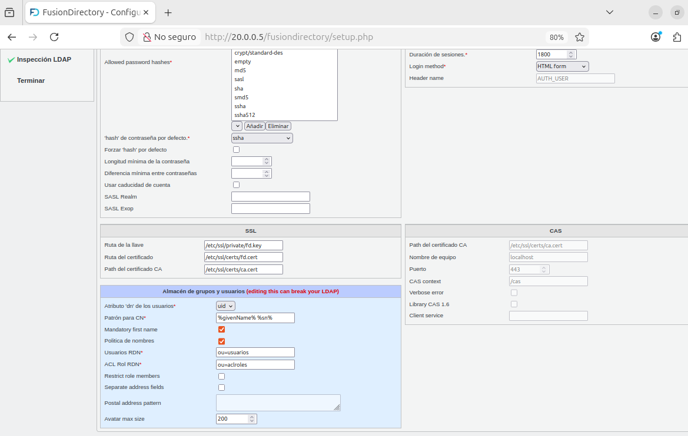

#### Inspección LDAP

El sistema analiza el directorio y puede mostrar avisos, por ejemplo, sobre usuarios fuera de `ou=usuarios` o departamentos no visibles.


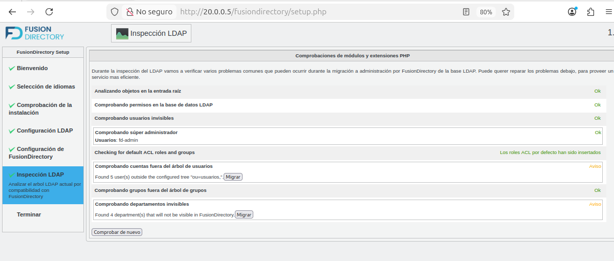

---

## Módulo B: despliegue del servidor NFS

### 1. Instalación

Instalamos el servidor NFS:

```bash
sudo apt install nfs-kernel-server -y
```

### 2. Creación del directorio y asignación de permisos

Creamos el directorio compartido y asignamos el grupo LDAP `seguridad`:

```bash
sudo mkdir -p /srv/nfs/seguridad
sudo chown root:seguridad /srv/nfs/seguridad
sudo chmod 770 /srv/nfs/seguridad
```

Con permisos `770`, el propietario (`root`) y los miembros del grupo `seguridad` pueden acceder al directorio; el resto de usuarios no puede entrar.

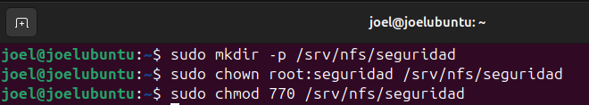

### 3. Configuración de `/etc/exports`

Editamos `/etc/exports`:

```bash
sudo nano /etc/exports
```

Como el servidor tiene la IP `20.0.0.5` y una máscara `/24`, permitimos la subred `20.0.0.0/24`:

```text
/srv/nfs/seguridad 20.0.0.0/24(rw,sync,no_subtree_check,root_squash)
```

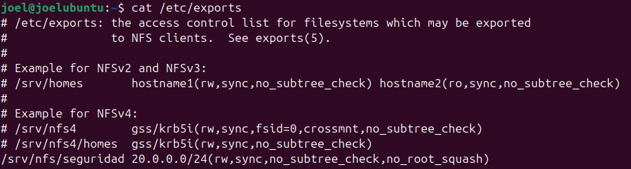


Aplicamos y verificamos los cambios:

```bash
sudo exportfs -ra
sudo exportfs -v
sudo systemctl status nfs-kernel-server
showmount -e localhost
```

El servicio debería aparecer como `active (exited)`. Con `showmount -e localhost` comprobamos que el directorio se exporta a `20.0.0.0/24`.

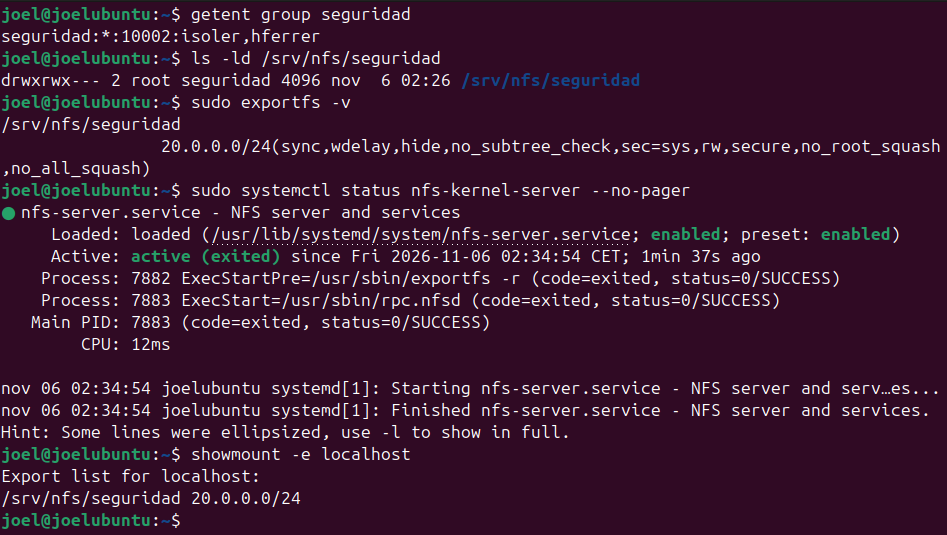

---

## Módulo C: verificación y resolución de problemas

Para comprobar la integración con LDAP, montamos el recurso y probamos el acceso con usuarios distintos.
```bash
sudo mount -t nfs 127.0.0.1:/srv/nfs/seguridad /mnt
```

### 1. Comprobación de grupos LDAP

Verificamos que los usuarios pertenecen al grupo esperado:

```bash
getent group seguridad
```

Salida:

```text
seguridad:*:10002:isoler,hferrer
```

Comprobamos también los permisos del directorio en el servidor:

```bash
ls -ld /srv/nfs/seguridad
```

Salida:

```text
drwxrwx--- 2 root seguridad 4096 nov 6 02:26 /srv/nfs/seguridad
```

### 2. Prueba de control de acceso

#### Acceso permitido

Montamos el recurso y probamos con `isoler`, que pertenece al grupo `seguridad`:

```bash
su - isoler
touch /mnt/prueba.txt
ls -l /mnt/prueba.txt
```

Salida:

```text
-rw-r--r-- 1 isoler seguridad 0 nov 6 02:42 /mnt/prueba.txt
```

El archivo se crea con el UID de `isoler` y el GID de `seguridad`.

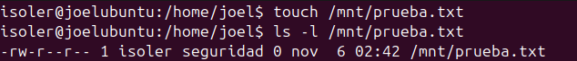

#### Acceso denegado

Probamos con `cmora`, que no pertenece al grupo:

```bash
su - cmora
touch /mnt/prueba.txt
```

Salida esperada:

```text
touch: no se puede efectuar 'touch' sobre '/mnt/prueba.txt': Permiso denegado
```

El acceso se deniega porque el cliente consulta los grupos mediante LDAP y `cmora` no pertenece a `seguridad`. Por tanto, los permisos `770` del directorio bloquean el acceso.

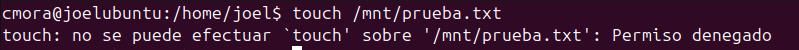
