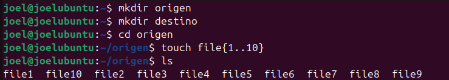
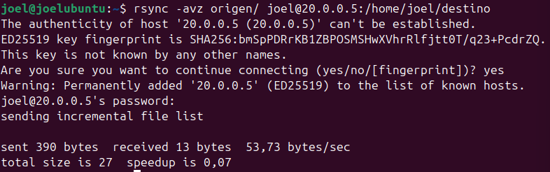
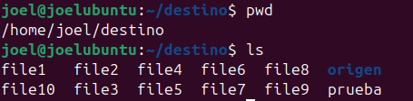
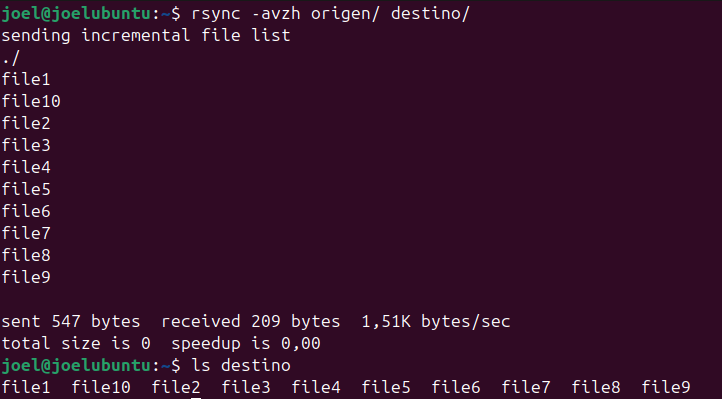
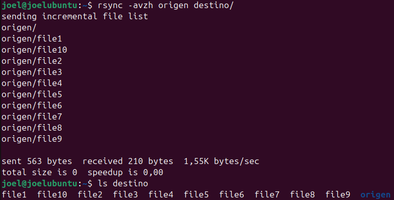
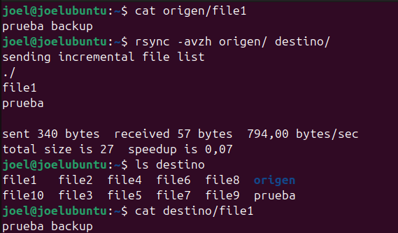
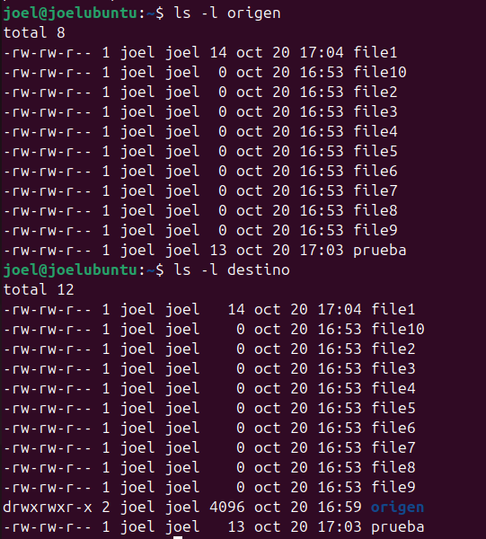
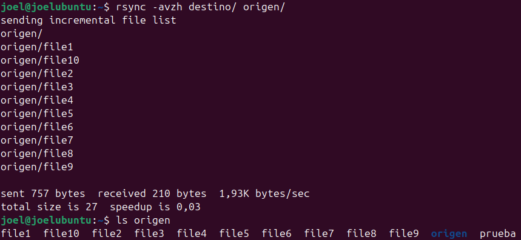

# Copias de seguridad incrementales con `rsync`

Esta actividad documenta el proceso de preparación, ejecución y comprobación de copias de seguridad incrementales con `rsync`. Las capturas de la carpeta `img/` sirven como evidencia visual de cada paso.

## Objetivo

Crear una copia de los datos de un directorio de origen en un destino, repetir la copia tras realizar cambios y comprobar tanto los archivos como sus permisos. Una copia incremental actualiza el destino con los cambios detectados, evitando tener que volver a copiar sin necesidad todos los datos.

## Evidencias

### 1. Preparar un archivo de prueba

La captura muestra la creación o manipulación de un archivo de prueba mediante `touch`. Este archivo permite verificar que los cambios realizados en el origen se reflejan en la copia.

### 2. Revisar el directorio de origen

Se inspecciona el contenido que se utilizará como fuente de la copia. Esta comprobación permite identificar los archivos que deben aparecer posteriormente en el destino.

### 3. Revisar el directorio de destino

Se comprueba el directorio que recibirá los datos. Comparar su contenido antes y después de la operación permite verificar el resultado de la copia.

### 4. Realizar la copia incremental

La primera captura de esta fase documenta la ejecución de la copia incremental con `rsync`.

La siguiente captura aporta una segunda evidencia de la copia incremental, por ejemplo, su repetición o la comprobación de su resultado.

### 5. Comprobar los cambios incrementales

Después de modificar el contenido del origen, se verifica que la siguiente ejecución detecta y aplica los cambios correspondientes en el destino.

### 6. Verificar los permisos

Además del contenido, conviene comprobar que los permisos de los archivos y directorios se conservan según las opciones utilizadas al ejecutar `rsync`.

### 7. Recuperar el contenido

La última captura documenta la recuperación o consulta del contenido respaldado. Esta comprobación ayuda a confirmar que los datos copiados siguen disponibles en el destino.

## Resumen del procedimiento

1. Preparar el directorio de origen y, si hace falta, un archivo de prueba.
2. Comprobar el contenido del origen y del destino.
3. Ejecutar `rsync` para copiar los datos al destino.
4. Realizar cambios en el origen y repetir la operación para actualizar la copia.
5. Verificar los archivos y sus permisos en el destino.
6. Comprobar que el contenido respaldado se puede consultar o recuperar.

> **Nota:** Las capturas documentan visualmente los pasos. Para reproducir exactamente la actividad, utiliza el comando de `rsync`, las rutas y las opciones que aparecen en la terminal de las imágenes; no se especifican aquí porque dependen de la configuración concreta de la práctica.
