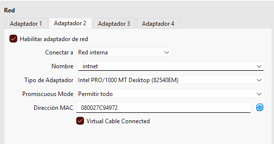
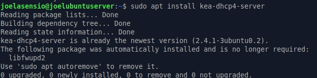
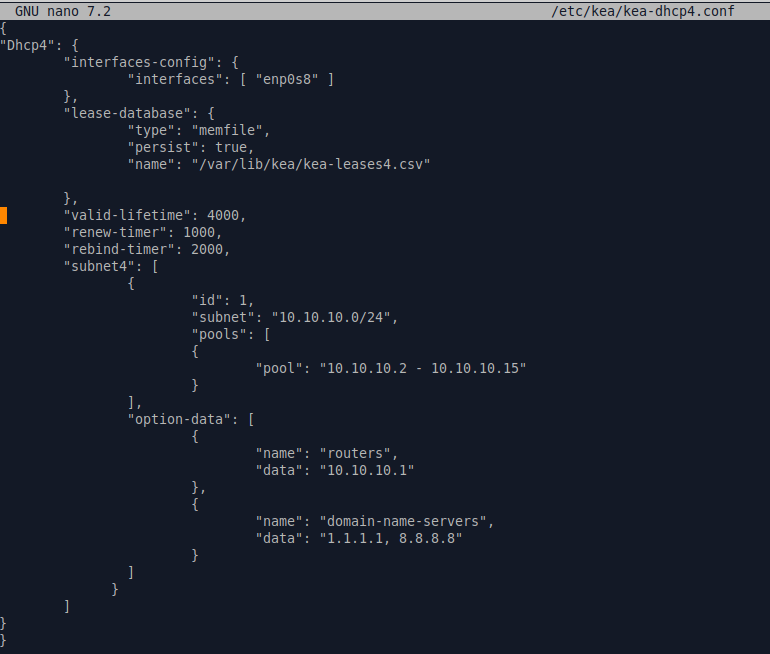
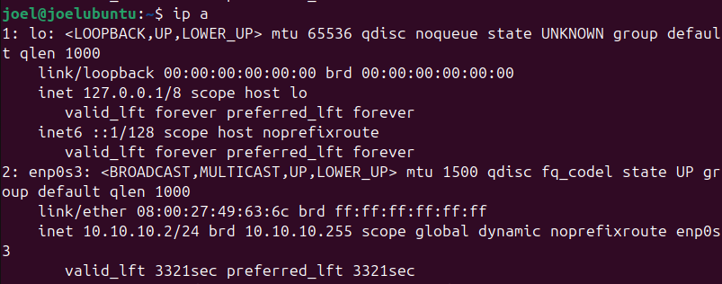

# DHCP con Kea

## Qué he hecho

He añadido el servicio DHCP con Kea en la máquina del DNS master, para que el cliente coja la IP solo y no tenga que ponérsela a mano.

## Red

Las dos máquinas están en la misma red interna de VirtualBox

En el servidor, el adaptador 2 lo he puesto en red interna y con el modo promiscuo en "Permitir todo" para poder darle ip al cliente.



La red que he usado es la `10.10.10.0/24`.

## Instalación

He instalado Kea en el servidor con:

```
sudo apt install kea-dhcp4-server
```



## Configuración


```
sudo nano /etc/kea/kea-dhcp4.conf
```


- Interfaz por la que reparte: `enp0s8`, que es la de la red interna.
- Las concesiones se guardan en `/var/lib/kea/kea-leases4.csv`.
- Cada IP dura 4000 segundos.
- Red `10.10.10.0/24`, con IPs de la `10.10.10.2` a la `10.10.10.15`.
- Gateway: `10.10.10.1`.
- DNS: `1.1.1.1` y `8.8.8.8`.



## Comprobación

Para ver si iba bien, he mirado la IP del cliente con `ip a`. Le ha dado la `10.10.10.2/24`, que está dentro del rango que puse, así que el DHCP funciona.


